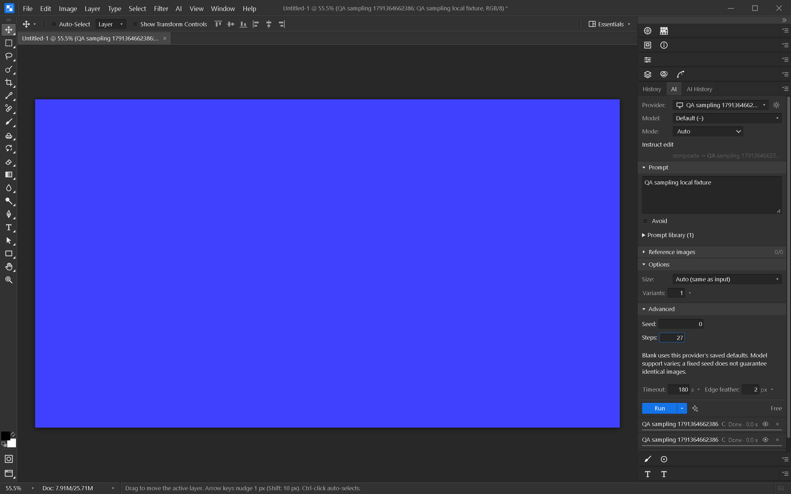

# Per-request seed and sampling steps

The AI panel's Advanced section exposes **Seed** and **Steps** for ComfyUI, Stable
Diffusion WebUI / Forge, OpenAI-compatible servers, Hugging Face, Replicate and fal.ai.
The selected endpoint/model must support these controls. Built-in OpenAI, Gemini,
Grok and prompt-only Ollama connections do not expose them.

Values remain separate for each provider during the session. Leave a field blank to
use that provider's saved configuration. Seed accepts whole numbers 0–2147483647;
steps accepts 1–150. A fixed seed does not guarantee reproducible images across
models, server versions or hardware. These are per-job overrides: they never modify
the provider registry. Change persistent defaults through Edit → AI Providers.

Generate, edit and contextual Generative Fill forward these values. AI History
records explicit overrides, and rerunning with the same provider restores them.
Rerunning with a different provider uses its defaults. Run on All uses each
provider's saved configuration. A blank field records no override; later changes
to saved defaults can therefore change a rerun.

Both the frontend and Rust command boundary reject unsupported/out-of-range values
before submitting a job. Normal provider errors still surface without retrying.

## Verification

- 749 frontend tests passed; Svelte check reported no errors or warnings.
- 67 Rust library tests and 16 custom-provider integration tests passed.
- Windows native app with a loopback WebUI fixture: generate/edit requests carried
  seed `0` and steps `27`; provider switching retained these values; steps `0`
  submitted no request; blank fields restored saved values `99` and `10`. The provider
  registry defaults remained unchanged. AI History displayed `0` / `27` and restored
  both values through Load into AI panel. This check made no vendor requests.

