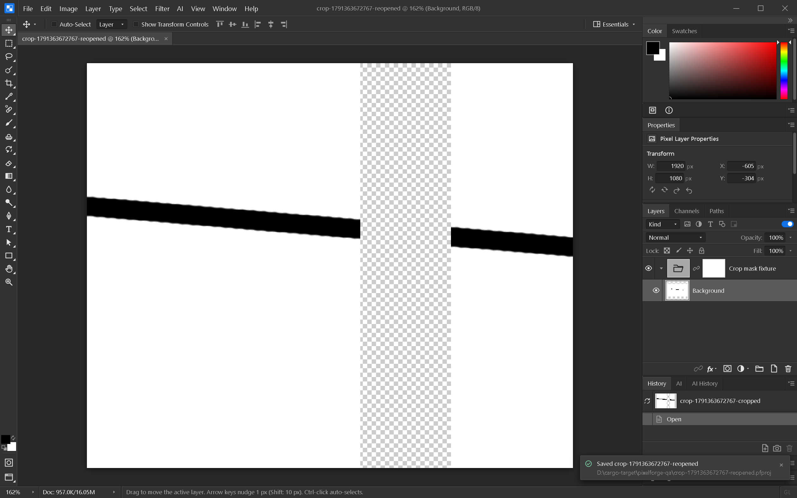

# Non-destructive crop

Turn off **Delete Cropped Pixels** in the Crop tool to reduce the canvas while keeping
off-canvas layer pixels. Canvas Size can expand the document to reveal them again.
The default checked option continues to discard cropped pixels.

Retained pixels, mask dimensions and editable shape/text/fill rendering bounds survive
project save/reopen. Crop undo/redo restores document dimensions and layer origins.
Selections and alpha channels follow the new canvas dimensions; they are not retained
as off-canvas layer content.

## Verification

- Frontend suite: 740 tests passed, including retained raster/masks, isolated and
  pass-through groups, editable shape/fill, project frames, recovery and history.
- Rust project I/O: 33 tests passed; one benchmark ignored. A group mask larger than
  its cropped canvas round-trips with exact bytes and origin.
- Windows native app: uncheck the option, crop a brush stroke inside a masked group,
  undo/redo, save, reopen and save again. Decoded layer and mask PNG bytes match the
  original fixture exactly. The reopened view was visually inspected.
- Duplicate shape coverage verifies retained rendering bounds are independently copied.

