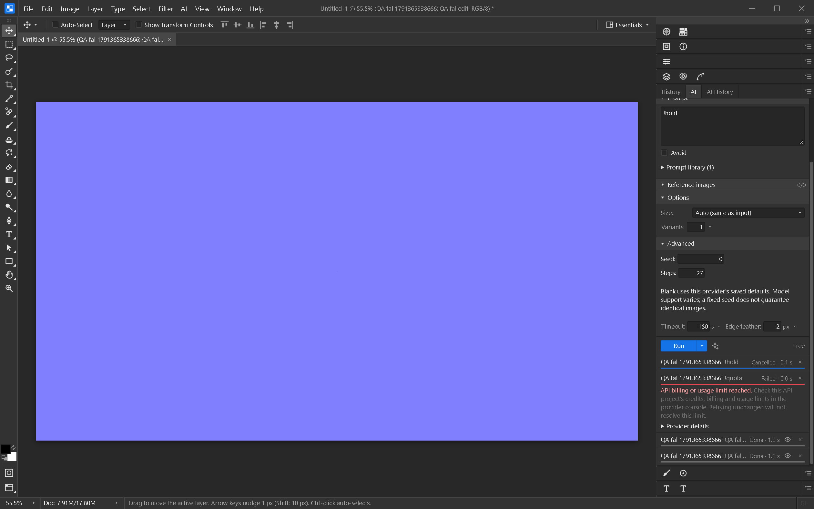

# fal.ai provider

Open **Edit → AI Providers → + Add → fal.ai**, paste your fal API key into **Token**,
then save. The key is stored through PixelForge's credential store, not in the provider
registry or project file. Requests originate in the Rust backend.

The preset uses `fal-ai/flux/dev` for generation and
`fal-ai/flux/dev/image-to-image` for edits. Selection editing uses PixelForge's mask
emulation. Configure another endpoint and its capabilities deliberately: fal model
input schemas differ, and this adapter targets image endpoints accepting `prompt`,
`num_images`, `image_url` for edits, and an `images[].url` result. Additional model
arguments can be supplied in Advanced JSON as `input`. The prompt, image, variant
count and explicit sampling controls take precedence over those arguments.

Seed, steps, CFG and edit strength are forwarded when configured. Negative prompts
are folded into the main prompt. The default preset does not claim native mask or
multiple-reference support. Enabling native masks for a compatible endpoint sends
`mask_url` with white indicating pixels to replace.

**Test connection** uses fal's authenticated pricing endpoint. It makes no image job
and does not prove sufficient credits or generation permissions. Hosted model prices
vary; PixelForge does not claim a fixed estimate for this provider.

Generation submits once, polls the returned status URL, then downloads results.
Errors do not trigger automatic paid resubmission. Credentials are sent only to
the configured queue server and the official pricing API. Returned queue URLs must
stay on the configured origin; redirects are rejected. Result downloads carry no key.

Cancel and local timeout request remote cancellation after fal has returned a queue
handle. Cancellation is best effort: an already-running model may still complete
and incur charges. If submission is interrupted before the response arrives, the
app has no handle with which to cancel. Check fal's dashboard in that case.

## Verification

Six Rust integration tests cover authenticated pricing, queue polling, images and
data-URI results, generation/edit endpoints, sampling, typed errors without retries,
cancel/timeout cleanup, model-path validation and credential isolation. Frontend
tests cover the fal preset and provider catalog. Live account generation remains
unverified; no vendor image requests were made during implementation.

Windows native verification used an owned loopback fixture through the real provider
dialog and AI panel. The read-only probe created no job; queued generation and edits
added layers with the correct endpoint and sampling parameters; a simulated quota
failure did not retry; Cancel issued a remote PUT. No page errors occurred. The
temporary provider was removed afterward. All 750
frontend tests passed and Svelte check reported no errors or warnings.
The full `pf-ai` suite passed all 151 tests.

## Official API references

- [Queue lifecycle and cancellation](https://fal.ai/docs/documentation/model-apis/inference/queue)
- [FLUX generation schema](https://fal.ai/models/fal-ai/flux/dev/api)
- [FLUX image-to-image schema](https://fal.ai/models/fal-ai/flux/dev/image-to-image/api)
- [Authenticated pricing lookup](https://fal.ai/docs/platform-apis/v1/models/pricing)
