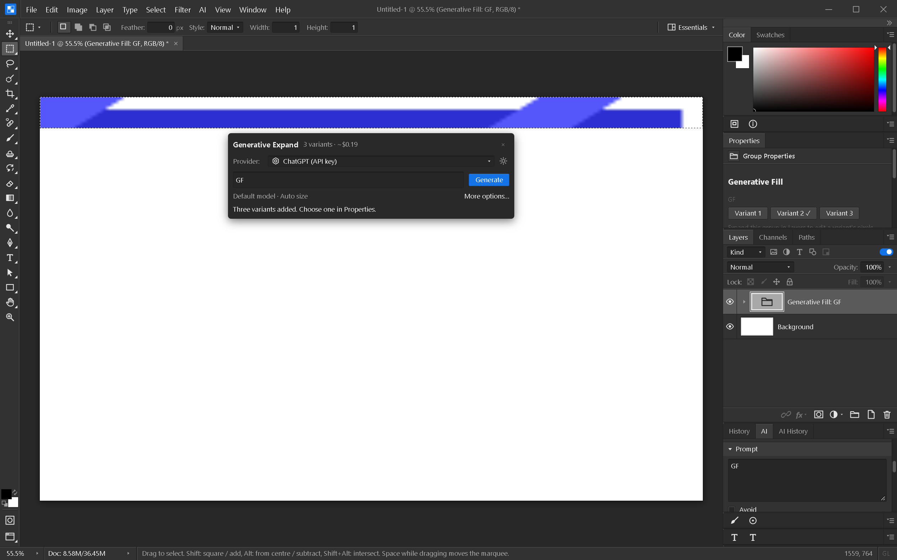

# Generative Expand

1. Choose the **Crop** tool and set **Fill → Generative Expand**.
2. Drag a crop handle outside the image. Expansion keeps the whole original canvas
   inside the crop; use Transparent mode for ordinary cropping.
3. Click **Commit**. The canvas grows and only the newly added area is selected.
4. Review the suggested prompt and provider in the floating task bar, then click
   **Generate**. The bar shows an estimate for three variants. Committing the crop
   does not contact a provider or start a billed image request.
5. Select a result with **Properties → Variant 1 / 2 / 3**.

Expansion uses the existing Generative Fill mask pipeline, with zero feather in the
task bar to keep generated pixels outside the original canvas. Results are ordinary
editable layers in a Generative Fill group. More options opens the AI panel, where
the user can deliberately adjust feathering and other request settings.

Preparing the canvas is one undo step. Adding the three generated variants is
another. A failed or cancelled request leaves the expanded canvas and selection
available for retry; undo the preparation if you want the original dimensions back.
Escape before committing discards the crop preview. Bounds are validated before
changing the document.

Engine tests cover expansion on each side and all sides together, original pixel
preservation, the exact new-area mask, undo/redo, and invalid bounds. Local fixture
verification does not establish vendor billing, image permissions or output quality.

Windows native verification (2026-10-07): the Crop options workflow sent a masked
three-variant request to the owned local fixture server. Variant switches and
undo/redo changed and restored the captured expansion pixels. Save As → close →
Open preserved the selected variant and produced an exact screenshot match at the
same zoom. A second save preserved every decoded layer and selection pixel. Quota
errors appeared inline without retries; immediate cancellation left pixels intact.

This test exposed and fixed a compositor bug: replacing a document-sized texture
retained the old sampling cache, leaving resized zoomed-out canvases unsmoothed until
reopen. Buffer creation now resets the cache. The full frontend suite passed 726
tests before that fix; all 12 compositor tests, including its new regression test,
passed afterward. Svelte check reported zero errors and warnings. The final native
build passed the complete expansion workflow above. No vendor image calls were made.

