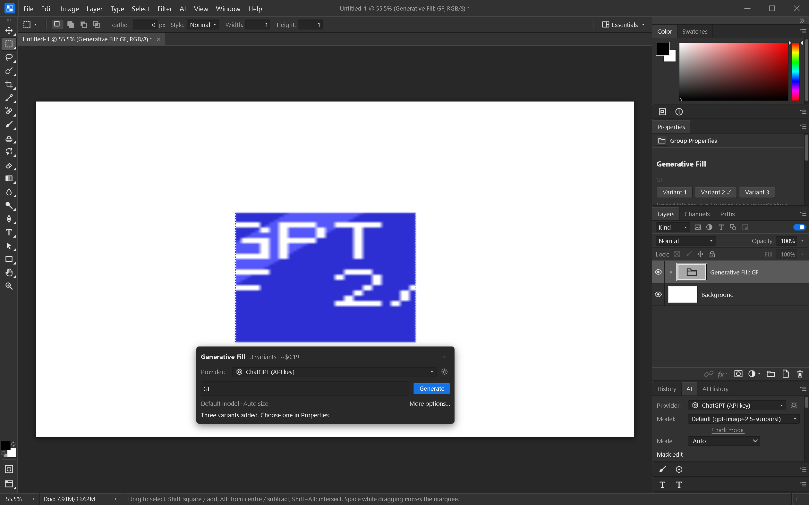

# Generative Fill

Make a partial selection, enter a prompt in the floating **Generative Fill** task
bar, select a provider, and click **Generate**. The bar shows the estimated cost
for three variants and uses the provider's default editing model and Auto size.
**More options…** opens the AI panel for model, size and other controls; the
**AI → Generative Fill…** menu command opens that panel directly.
The operation requests three variants and uses the
existing native-mask or mask-emulation pipeline. Normal provider image charges apply.
The panel's cost estimate uses three variants. A missing selection or a provider
that supports fewer than three variants prevents this operation.

Results appear as one collapsed **Generative Fill** group. The group contains three
ordinary editable pixel layers and shows one at a time. Select the group and use
**Properties → Variant 1 / 2 / 3** to switch. Each switch is undoable. Expand the group
to edit a variant's pixels; those edits remain when switching away and back.

The group records its prompt, provider, model and child IDs in the optional
`generative` manifest field. Result pixels use the existing layer PNG entries, so
they are not duplicated as base64 in the manifest. Duplicating the group remaps
variant references to the copied children. Older readers can display the ordinary
group and visible child without understanding the extra metadata.

Generation adds the entire group in one undo step. If the document was closed or
resized while the request ran, results are not applied to a differently sized canvas.
Receiving fewer than three results is reported rather than silently creating an
incomplete Generative Fill group.

Windows verification (2026-10-07): 720 frontend tests passed; Svelte check reported
no errors or warnings. The rebuilt native app's inline prompt sent a three-result
mask request to the local fixture server. Hide/reselection restored the bar,
typing preserved its position, and a simulated quota failure appeared inline with
no retry. Immediate cancellation returned the bar to an idle state without changing
the canvas. Properties switching changed the rendered selection, undo/redo
restored exact captured pixels, and native Save As → close → Open preserved both the
selected variant and the other switchable result pixels. No vendor image request
was involved.

The task bar follows the selection as the viewport moves, stays within the canvas
view, and hides for empty, full-canvas or wholly offscreen selections. Its close
button hides it until the selection changes. An active job exposes Cancel and
prevents another submission from the bar. Provider errors appear beside the prompt.
The broader contextual actions for active layers remain unfinished. Live vendor
generation and OAuth verification also remain separate gates.
