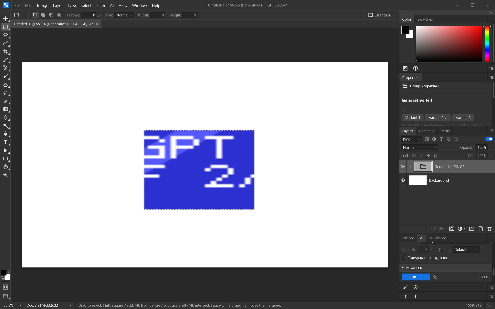

# Generative Fill

Make a partial selection, choose **AI → Generative Fill…**, enter a prompt, select
a provider, and click **Run**. The operation requests three variants and uses the
existing native-mask or mask-emulation pipeline. Normal provider image charges apply.
The panel's cost estimate uses three variants. A missing selection or a provider
that supports fewer than three variants prevents this operation.

Results appear as one collapsed **Generative Fill** group. The group contains three
ordinary editable pixel layers and shows one at a time. Select the group and use
**Properties → Variant 1 / 2 / 3** to switch. Each switch is undoable. Expand the group
to edit a variant's pixels; those edits remain when switching away and back.

The group records its prompt, provider, model and child IDs in the optional
`generative` manifest field. Result pixels use the existing layer PNG entries, so
they are not duplicated as base64 in the manifest. Duplicating the group remaps
variant references to the copied children. Older readers can display the ordinary
group and visible child without understanding the extra metadata.

Generation adds the entire group in one undo step. If the document was closed or
resized while the request ran, results are not applied to a differently sized canvas.
Receiving fewer than three results is reported rather than silently creating an
incomplete Generative Fill group.

Windows verification (2026-10-07): 717 frontend tests passed, followed by a passing
targeted test for an incomplete provider response; Svelte check reported no errors
or warnings. The rebuilt native app sent a three-result mask request to the local
fixture server. Properties switching changed the rendered selection, undo/redo
restored exact captured pixels, and native Save As → close → Open preserved both the
selected variant and the other switchable result pixels. No vendor image request
was involved.

The selection contextual task bar and its inline prompt workflow remain to be
implemented. This command-and-panel workflow is not completion of the full
`PLAN-v3.md` Generative Fill UX requirement. Live vendor generation and OAuth
verification also remain separate gates.
