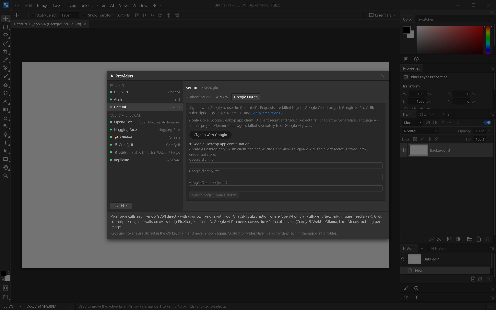
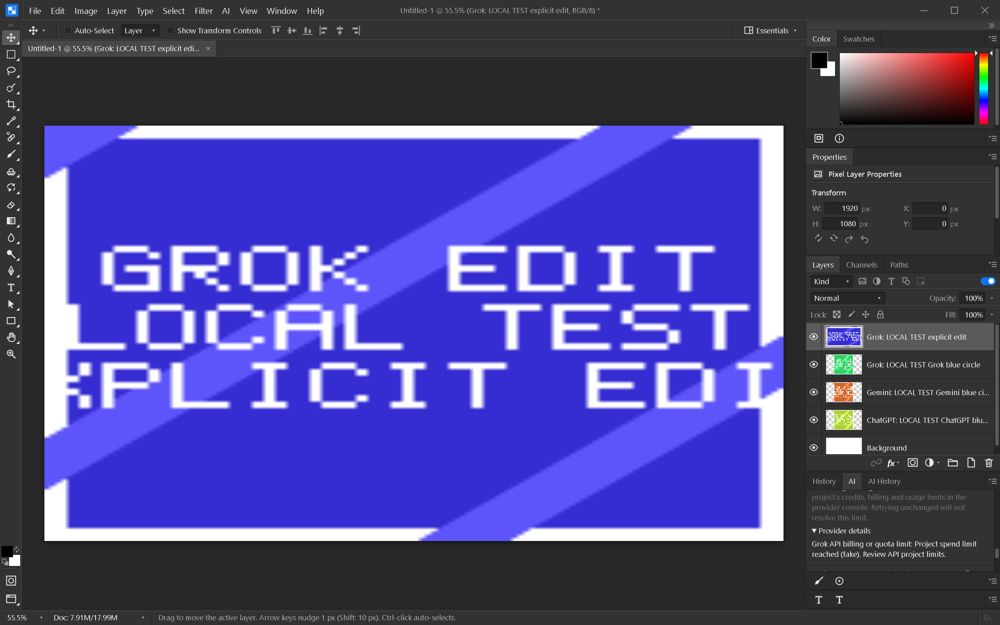

# Provider sign-in

Open **Edit → AI Providers** and choose a provider and authentication method.

To make an image, use **AI → Generate with AI…**, enter a prompt in the AI panel,
choose the provider, then click **Run**. The command now reveals the panel and opens
the prompt section even when History was selected or the dock was collapsed.
The **Mode** picker lets you choose Generate, whole-image edit, selection edit, or
Auto. An explicit choice stays selected after success or failure and when switching
providers; Run no longer silently resets Generate to an edit. Auto uses the current
document and selection. The mode description below the picker shows the resolved
operation, including when an edit falls back because no editable image is available.
The connection test checks authentication only; it does not generate an image or
prove that the account has image-model access, billing or sufficient quota.
Use **Check model** below the AI panel's model picker to query the selected model's
metadata with the configured credentials. This is a read-only check, available for
built-in API connections (including Gemini OAuth). It can reveal a missing model or
access error without submitting an image request. A successful metadata lookup still
does not prove image-generation permission, billing or quota.
The panel-reveal fix passes 99 AI tests and a rebuilt Windows UI check: both OpenAI
and Gemini can be selected, a prompt entered, and Run becomes enabled. That check
did not submit a billable image request and is not evidence of successful generation.

| Provider | Connection | Remaining setup / limits |
|---|---|---|
| ChatGPT | Existing Sign in with ChatGPT, PKCE loopback | Plan usage supports eligible text requests (Improve prompt). Image access remains subject to OpenAI's restrictions; use an API key for images. |
| Gemini | Google OAuth, PKCE loopback | Configure a Google **Desktop app** client ID, client secret and Cloud project. API usage is billed separately from Google AI plans. |
| Grok | Existing xAI device authorization | Requires an OAuth client ID issued to Pixelforge by xAI. No client ID is bundled. |

## Gemini setup

1. Enable the **Generative Language API** in your Google Cloud project and configure
   its OAuth consent screen/test users.
2. Create a **Desktop app** OAuth client in Google Auth Platform. Use the ID and secret
   from its downloaded credentials, plus the project's ID or number.
3. Select **Gemini → Google OAuth**, enter these three values and save. The client
   secret goes into the existing credential store, never `settings.json` or project files.
4. Choose **Sign in with Google**, grant access in your system browser, and return to
   Pixelforge. A local callback verifies state and exchanges the code using S256 PKCE.
5. Generate/edit images normally. Requests send a bearer token and
   `x-goog-user-project`; OAuth tokens are never sent as API keys. Google project
   permissions, API availability, quota and billing still apply.

The requested scope is `https://www.googleapis.com/auth/cloud-platform`, as in Google's
Gemini OAuth quickstart. No email/profile scopes are requested. The UI therefore shows
“Google account connected” without claiming an unverified account identity.
Tokens and the desktop client secret are protected by the existing credential store.
Refresh tokens are retained when Google omits them from refresh responses. Sign out
attempts revocation and deletes the local token record. Sign out before replacing
configuration. API-key mode stays available; OAuth errors do not silently switch to it.

## Verification boundaries

Mock-server tests exercise Google code exchange, refresh, bearer/quota headers, image
response decoding, revocation and API quota errors. They do not establish a successful
sign-in or image request against a real customer account. The v0.3 live-provider and
cross-OS gates remain open.

Windows follow-up (2026-10-07): saved-key authentication checks succeeded for OpenAI
and Gemini; xAI rejected its saved key. No billable vendor image requests were sent.
The native **Check model** action also successfully retrieved metadata for OpenAI's
`gpt-image-2.5-flare` and Gemini's `gemini-3.1-flash-image` using the saved keys.
The Grok model check was rejected for an invalid key. These metadata checks created
no image jobs. Three adapter tests verify metadata-only GETs, error propagation and
rejection of invalid model paths; all 100 frontend AI tests and Svelte check passed.
An isolated native app using a loopback fixture server added an OpenAI-generated
image layer, then Gemini and Grok edited-image layers. A simulated project spending
limit produced an actionable error, no extra layer, and no automatic retry. Failed
jobs now offer **Provider details** so the returned message can be read and copied.
After the mode-picker fix, a second native check generated through all three adapters
without attaching the document composite, switched explicitly to a Grok edit with an
image input, and preserved Generate after a simulated quota failure. All four
successful fixture responses added layers. The 100 frontend AI tests and Svelte
check passed; the Windows native build succeeded. These fixture results verify
application plumbing, not live model access or billing.

Local verification (Windows, 2026-10-06): 649 frontend tests; Svelte check with zero
errors/warnings; 191 Rust tests passed (two existing fixture/benchmark helpers ignored);
Clippy with warnings denied; Tauri native build.
The built Windows executable was launched and tested through its real WebView: Ctrl+F
and Ctrl+K, all three auth panels, missing-configuration gates, and rejection of an
invalid Google project through real IPC. No JavaScript page errors were observed.
The temporary app-specific WebView debugging setting was removed after the checks.

## Official references

- [OpenAI model metadata](https://developers.openai.com/api/reference/resources/models/methods/retrieve)
- [Gemini model metadata](https://ai.google.dev/api/models)
- [xAI model metadata](https://docs.x.ai/developers/rest-api-reference/inference/models)
- [Google Gemini OAuth](https://ai.google.dev/gemini-api/docs/oauth)
- [Google installed-app OAuth and PKCE](https://developers.google.com/identity/protocols/oauth2/native-app)
- [OpenAI open-source sign-in](https://developers.openai.com/siwc/token-sharing-open-source)
- [OpenAI plan limitations](https://developers.openai.com/siwc/token-sharing-open-source/preview-limitations)
- [xAI discovery metadata](https://auth.x.ai/.well-known/openid-configuration)

## Build

Use `npm run build:release` for a release executable without an installer. It invokes
Tauri's build pipeline, including the frontend build. A bare `cargo build --release`
does not run that frontend step and can use missing/stale assets or the wrong protocol.
For Windows, use the MSVC Rust toolchain (for example set
`RUSTUP_TOOLCHAIN=stable-x86_64-pc-windows-msvc` in Git Bash). Set `CARGO_TARGET_DIR`
to a volume with adequate free space; this session uses `D:/cargo-target/pixelforge-msvc`.
