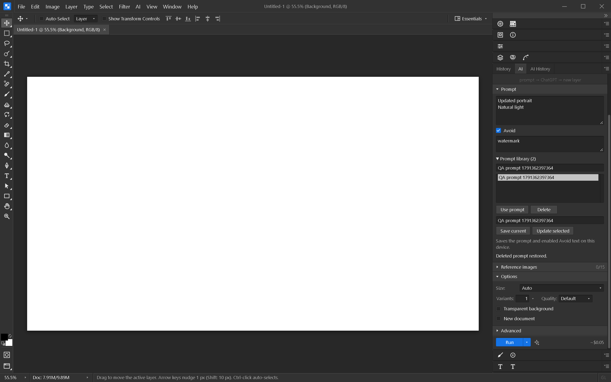

# Prompt library

Open **AI → Generate with AI…**, expand **Prompt**, then open **Prompt library**.
Enter a prompt and optional Avoid text, give it a name, and choose **Save current**.
Search by name or text, select an entry and choose **Use prompt** to load it into the
form. Loading never starts generation or changes the provider/model.

**Update selected** replaces the chosen saved entry with the current name, prompt
and enabled Avoid text. Duplicate names are rejected. Delete has an **Undo delete**
action for the last deletion while the panel remains mounted.

The library lives in the native app settings file, shared across documents and
retained after restart. Browser preview uses its existing local settings shim. The
library holds up to 200 entries, names up to 80 characters and each prompt field up
to 20,000 characters. It stores only ID, name, prompt and negative prompt; provider
credentials and reference images are not included.

If settings cannot be read, library writes are disabled to avoid overwriting unread
data. Failed saves show an error and restore the previous in-memory library; a later
retry can succeed. Saved entries are validated when loaded.

Windows verification (2026-10-07): all 734 frontend tests passed, including invalid
records, duplicate names, limits, strict storage failures and retry after failure.
Svelte check reported no errors or warnings. The final rebuilt native app saved and
updated a multiline prompt, closed and restarted its process, then searched and
restored both prompt fields. Delete and undo-delete passed as well. No generation
was submitted during this test.

