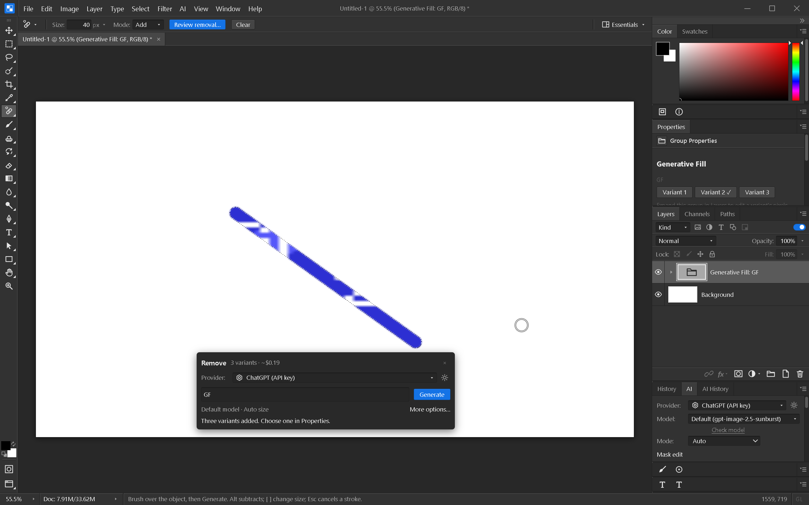

# Remove tool

Right-click the healing tools slot and choose **Remove Tool**. Brush over the object
you want removed. Add more strokes to cover it, hold Alt (or choose Subtract) to trim
the marked area, and use the Size control or brackets to adjust the brush.

The floating **Remove** bar supplies a removal prompt. Review the prompt, provider
and three-variant estimate, then click **Generate**. Brushing does not submit an AI
request. **Review removal…** opens the AI panel for additional settings. Leave some
surrounding image unmarked to give the provider context.

Results use the existing masked editing pipeline and appear in an editable
Generative Fill group. **Properties → Variant 1 / 2 / 3** switches results. Original
layers remain available underneath; normal provider image charges apply.

Each completed brush stroke is a separate undo step. Escape during a stroke restores
the selection that existed before it. Clear removes the marked area with undo support.
The first stroke starts a fresh removal area rather than adding to an unrelated
selection. Subsequent strokes preserve a custom prompt, including after undoing a
stroke. Subtraction and brushing outside the canvas are clipped to the image.

This is the AI-backed Remove workflow. The separate optional local LaMa inpainting
model from `PLAN-v3.md` is not implemented by this tool.

Windows verification (2026-10-07): all 729 frontend tests passed; Svelte check had
zero errors and warnings. The rebuilt native app selected Remove through the healing
fly-out, painted a continuous diagonal area, and displayed the supplied removal
prompt. A local fixture quota error appeared inline without retry. Generation sent
three masked variants, Properties switching changed pixels, and undo/redo and native
save/reopen restored an exact interior pixel sample. Immediate cancellation preserved
that sample. The screenshot below uses fixture output, not vendor-generated content;
live removal quality and the separate OAuth gates remain unverified.

