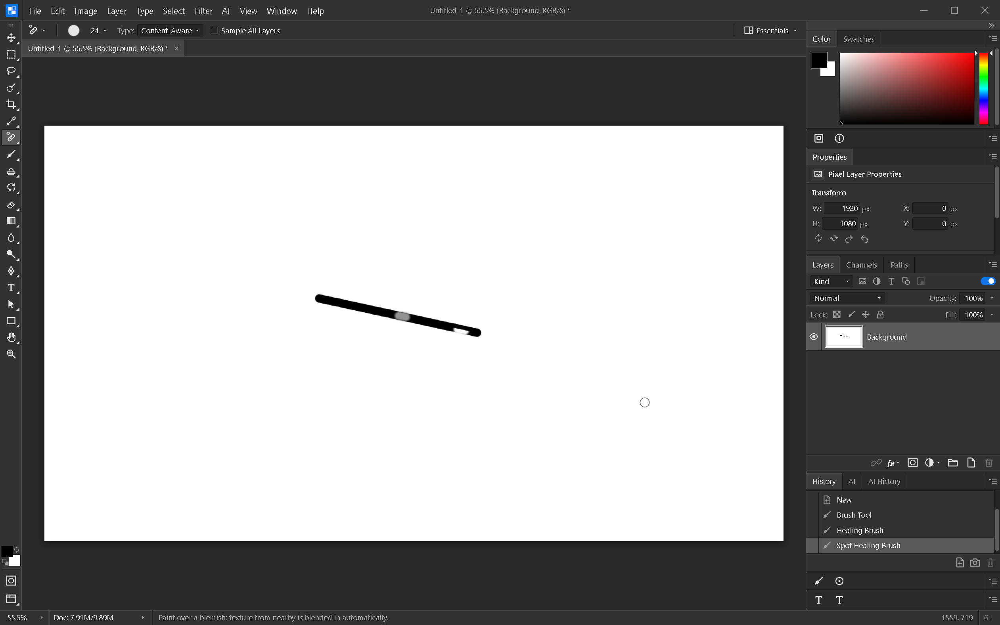

# Healing on tiled layers

Sampled Healing Brush now reads only the stroke bounds and the surrounding area
needed for color statistics and feathering. It obtains coverage per pixel from the
stroke's sparse mask, heals a small temporary raster, and writes the touched area
back into the tiled layer.

Spot Healing uses the same bounded write path. Automatic source search reads a
region large enough to include every candidate offset and its comparison ring. It
preserves the existing candidate order, scoring and early-exit behavior. Proximity
Match and Create Texture keep their existing semantics.

The brush completion hook returns the region changed by post-processing. Undo and
GPU invalidation include the union of that region and the brush's dirty rectangle,
so pixels in the feathered edge are also restored and redrawn.

Tests compare the bounded and old dense healing output byte for byte across tile
boundaries and image edges, with positive/negative source offsets and Normal/Replace
modes. Automatic source-search offsets match the dense implementation in six cases.
A 4000×3000 sparse-layer test heals a small area without materializing either source
or destination and bounds the added tile storage.

This is not the full large-document memory gate. Sample All Layers still composites
the document into a dense source, Patch still uses the older dense mask path, and the
plan's 30-layer/200-undo application memory benchmark remains unverified.

Windows verification (2026-10-07): all 736 frontend tests passed, Svelte check had
zero errors and warnings, and the debug native build succeeded. In the real app,
both Alt-sampled Healing Brush and automatic Spot Healing changed a painted blemish.
Undo restored the entire captured area exactly; redo restored the healed pixels
exactly. No page errors occurred.

